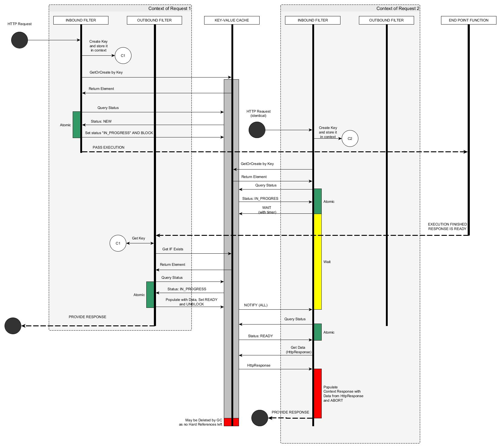

# Server-side caching filter for Dropwizard/Jersey.

Licence: Apache 2.0

How to use:

In main application: Register the cache
---
  	@Override
  	public void run(final MainConfiguration configuration, final Environment environment) {
   	 environment.jersey().register(
        new CachingFilterFeature(
            Arrays.asList("Accept"), // list of HTTP request headers to use for key in addition to the method (e.g. GET) and URL
            CacheBuilder.newBuilder().softValues().build()
        ));
		...
	}
---

In resource: Instruct caching filter to cache operations per method
---
  	@GET
  	@Produces(MediaType.APPLICATION_JSON)
  	@Path("/cached")
  	@ResponseCachedByFilter(10000)
  	public Object getCached() {
    	return dao.get();
  	}
---

Parameter -- TTL of the cache entry in milliseconds.

# TTL and the lease of a producer

Two different things:

- the **TTL** of an entry says how long a cached value stays valid. It is a property of the
  annotated method.
- the **lease** of a producer says how long a producer may work on a value, and therefore how long
  the requests waiting for that value may wait for it. It is a property of the filter and defaults
  to 10 seconds.

A resource may well be slower than the TTL of its entry: the TTL says how long the value is
served, not how long it takes to produce it. The requests that arrive while the value is being
produced wait for that producer instead of calling the resource themselves, so the value is
produced once and cached.

The lease is the safety net: when it is over, the producer is considered to be gone, and one of
the waiting requests takes the entry over. A request that has waited for the whole lease while
the producer is still alive does not take the entry over: it goes to the resource itself and
leaves the entry to the producer, whose result will serve the requests that follow.

# What is not cached

Only successful responses are cached. A response with a status of 400 or above is never stored in
the cache: the requests waiting for it are released, and one of them calls the resource again.

This is a deliberate decision. An error is usually a temporary condition (an overloaded
downstream, a timeout, a broken dependency), and serving it from the cache would spread that
condition over the whole TTL, turning a short outage into a long one. The price is that during
such an outage every request reaches the resource. If your deployment prefers the predictability
over the load, cache the errors in the resource itself and let the filter deal with the successful
responses only.

A failed entry holds no data, but it stays in the cache for a while: it is the point where the
requests that were waiting for the failed producer meet, and the next request for that key takes
it over. Once the lease of that producer is over, the failed entry is removed from the cache.

**The lease must be longer than the slowest response of the resource, not the average one.**
The lease is a timeout for a producer that is presumed dead, not an estimate of how long the
resource takes. A producer that outlives its lease loses the entry, and its result is thrown away.
With a lease shorter than the resource, this happens to every producer: nothing is ever cached,
and every request waits for the lease and then calls the resource anyway, which is worse than
having no cache at all. Take the worst response time you are prepared to tolerate and add a
generous margin.

# Principal diagram

